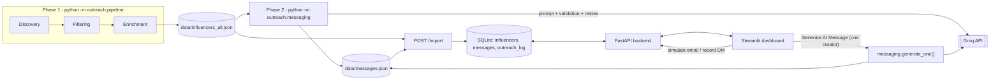

# StyleNest – Automated Micro-Influencer Outreach System

EDXSO AI Engineer Intern – Assignment 1 submission.

> **Draft status (delete this block before submitting).** Sections marked **TODO** describe parts of the repository
> that could not be inspected when this README was written (discovery, filtering, enrichment, `api.py`,
> `requirements.txt`, `.env.example`, datasets). Everything else was taken from the code in
> `outreach/messaging.py`, `outreach/llm_service.py`, `outreach/db.py`, `outreach/dashboard.py` and their tests.

## 1. Project Overview

This system helps the fictional fashion and beauty brand **StyleNest** find micro-influencers on YouTube, decide which
ones qualify, prepare a personalised email and Instagram DM for each qualified creator, and track every contact
attempt. It replaces manual spreadsheet research and copy-pasted outreach with a repeatable pipeline and a review
dashboard.

Safety by design: nothing is sent automatically. Email actions are **simulated by default**, and Instagram DMs are
**never sent by the system** – the user copies the text, sends it by hand, and records the outcome.

## 2. Key Features

| Feature | Where it lives |
|---|---|
| Influencer discovery (YouTube) | Phase 1: `python -m outreach.pipeline` — **TODO: confirm module and the 50+ result count** |
| Filtering and qualification (`PASS` / `FAIL` with reasons) | Phase 1 output field `filter_status`, `filter_reasons` — **TODO: list criteria** |
| Profile enrichment (contact email, Instagram, website, themes, recent videos) | Phase 1 output — **TODO: confirm sources** |
| AI-generated email + Instagram DM (Groq) | `outreach/messaging.py`, `outreach/llm_service.py` |
| On-demand generation for one selected creator | "Generate AI Message" button in `outreach/dashboard.py` → `messaging.generate_one()` |
| Email simulation | Email actions record a `simulated` outcome unless real sending is explicitly enabled |
| Manual Instagram DM workflow | Dashboard copy buttons + "Mark DM as sent manually / failed" |
| Outreach tracking and duplicate prevention | SQLite `outreach_log` with partial UNIQUE indexes (`outreach/db.py`) |
| Streamlit dashboard | `outreach/dashboard.py` |

## 3. Technology Stack

Verified from imports in the inspected files:

- **Language:** Python 3 (uses `from __future__ import annotations`, `X | None` type hints)
- **AI:** Groq chat-completions via the `groq` SDK. Default model `llama-3.3-70b-versatile`, overridable with
  `GROQ_MODEL` or `--model`. **TODO: state the model used for your submitted `messages.json` (the `model` field in
  that file records it).**
- **Backend:** FastAPI app factory `outreach.api:create_app`, served with `uvicorn`
- **Dashboard:** Streamlit, `pandas`, `requests`, `python-dotenv`
- **Database:** SQLite (`sqlite3`, foreign keys on)
- **Data models:** `outreach/models.py` (`Influencer`, `RecentVideo`; dumped with `model_dump`, so Pydantic)
- **Tests:** `pytest` (plus Streamlit's `AppTest` for dashboard tests)
- **Discovery source:** YouTube — **TODO: name the API/library and endpoints used**

## 4. System Architecture

Workflow: **Discovery → Filtering → Enrichment → AI Personalization → Review → Sending/Simulation → Tracking.**



Phase 1 and Phase 2 write JSON files; `POST /import` (the "Import or refresh data" sidebar button) loads them into
SQLite without resetting outreach statuses. The dashboard reads and writes through the API, except for on-demand
generation, which calls `outreach.messaging` in the Streamlit process and then triggers `POST /import`.

## 5. Project Structure

Only files confirmed from the inspected code are listed; **TODO: replace with the output of `tree -I ".venv|__pycache__"`.**

```
.
├── outreach/
│   ├── config.py          # loads .env; DATA_DIR, BRAND_NAME, SENDER_NAME, COLLAB_TYPE, BRAND_DESCRIPTION
│   ├── models.py          # Influencer, RecentVideo
│   ├── pipeline.py        # Phase 1 entry point (python -m outreach.pipeline)
│   ├── llm_service.py     # Groq wrapper: bounded retries, rate-limit aware, typed errors
│   ├── messaging.py       # Phase 2: prompts, validation, fallback, batch runner, generate_one()
│   ├── db.py              # SQLite schema + queries, duplicate-outreach constraints
│   ├── api.py             # FastAPI app (create_app)
│   ├── view_helpers.py    # dashboard formatting helpers
│   └── dashboard.py       # Streamlit UI
├── data/
│   ├── influencers_all.json   # Phase 1 output (all creators, PASS and FAIL)
│   └── messages.json          # Phase 2 output
├── tests/
├── requirements.txt       # TODO: verify
├── .env.example           # TODO: verify
└── README.md
```

## 6. Influencer Discovery

**TODO – not inspected.** Describe: the YouTube API/data source, search queries or seed strategy, how many creators
were discovered, and how the minimum of 50 influencers is met (the dashboard KPI "Total creators" shows the number
imported; the "Qualified" KPI shows how many passed).

## 7. Filtering and Classification

Every creator in `influencers_all.json` carries `filter_status` (`PASS` or `FAIL`) and a list of `filter_reasons`
(for example `PASS platform: YouTube`, `PASS followers: 12,000` in the dashboard test data). Failed creators are kept in
the dataset and shown in the dashboard with their reasons ("Why this creator did or did not qualify"), but
**never receive messages**: Phase 2 and on-demand generation only process `PASS` records.

**TODO – list the exact criteria and thresholds from the filter module** (platform, follower range, engagement,
niche, recency, country, etc.).

## 8. Profile Enrichment

Fields stored per creator (from the `influencers` table and Phase 1 records): `channel_id`, `name`, `platform`,
`profile_url`, `niche`, `follower_count`, `engagement_rate`, `content_themes`, `contact_email`, `email_source`,
`instagram_url`, `website`, `creator_country`, `field_status`, `last_upload_at`, and `recent_videos`
(id, title, URL, publish date).

- **Missing contact email** is stored as the literal `"Not Found"`; the dashboard shows "No public email found" and email
  outreach is skipped for that creator.
- **Missing followers/engagement** are `null` and shown as not available ("Empty followers or engagement means the
  value is not available from the public API").
- `field_status` records per-field availability. **TODO: document its values.**
- **TODO:** how emails/Instagram links are extracted (the dashboard labels the source, e.g. `email_source`).

## 9. AI Message Personalization

**Model and service.** `GroqService` (`llm_service.py`) wraps Groq chat completions with `max_retries=3`, exponential
backoff (2 s base, 30 s cap), `Retry-After` support, and distinct errors: `MissingAPIKeyError`, `LLMFatalError`
(auth/bad request – never retried), `LLMTransientError` (rate limit/overload/network), `LLMResponseError` (empty
response).

**Personalization signals.** Only verified Phase 1 facts are sent to the model: creator name, platform, niche,
content themes and up to three recent video titles, plus the sender's name, brand, brand description and
collaboration type. The creator's email address, description and metrics are **not** sent.

**Prompt rules** (system prompt in `messaging.py`): reply with JSON `{subject, email, dm}`; email 60–90 words, DM 15–30
words, subject ≤ 10 words; use only provided facts; quote only exact video titles; no placeholders, brackets or
links; never claim to have watched or loved specific content.

**Validation.** Email 60–90 words, DM 15–30 words, subject ≤ 12 words, no placeholders/brackets/links, and any quoted
text of two or more words must be a provided video title.

**Retries and fallback.** Up to 3 attempts per creator; on failure the validation problems are fed back to the model.
If all attempts fail, a deterministic template is used (facts only, also validated against the same word limits) and
labelled `source: fallback_template` with status `fallback_after_invalid_output`. With no themes or video titles the
model is not called (`fallback_insufficient_context`). Templates are shown in the dashboard as **"Standard template"**
and never as AI-generated.

**Batch generation (CLI).**

```bash
python -m outreach.messaging                 # all qualified creators without a valid message
python -m outreach.messaging --limit 2       # at most 2 creators
python -m outreach.messaging --force         # regenerate even if a valid message exists
```

Other flags: `--input`, `--output`, `--delay`, `--model`. Valid messages are reused on re-runs; the run stops after 3
consecutive API failures or on a fatal API error, keeping progress.

**On-demand generation for one creator (dashboard).** Select a qualified creator in "Creator review":

- No message, or only a template → **Generate AI Message**.
- Valid AI message already stored → it is displayed, with an explicit **Regenerate AI message** button.

A click generates for **that creator only** via `messaging.generate_one()`, using the same prompt, validation, retry
and fallback logic. A valid existing message is reused with no API call unless regeneration is requested, and a failed
regeneration never overwrites a valid message. The result is saved to `messages.json`, then `POST /import` refreshes
the tracker. No Groq call happens unless the button is clicked.

## 10. Sending Layer and Outreach Tracking

- **Email:** the default is **simulation**: the action records a `simulated` outcome and no email leaves the machine.
  The code also contains an SMTP mode that is only active when real sending is explicitly enabled (the dashboard then
  shows a "REAL SENDING IS ENABLED" banner and requires a confirmation checkbox per send). **TODO: document how it is
  enabled and its variables, or state that it was not used for the submission.**
- **Instagram DM:** never sent by the system. Copy the DM, send it manually in Instagram, then click "Mark DM as sent
  manually" or "Mark DM as failed" (optional note).
- **Statuses** (`outreach_log`): `pending`, `sent`, `simulated`, `failed`, `skipped`; channels `email` and
  `instagram_dm`; modes `simulation`, `smtp`, `manual`. The dashboard labels simulated outcomes as
  "Simulated (not sent)".
- **Duplicate prevention** is enforced by the database: partial UNIQUE indexes allow only one active
  (`pending`/`sent`) or `simulated` record per creator and channel, and one per email address
  (case-insensitive). A second attempt raises `DuplicateOutreach`. Re-importing data never resets statuses.

## 11. Dashboard and API

**Dashboard sections:** sidebar (import/refresh, search, filters); KPI cards and creator funnel; a creator table;
"Creator review" (profile, qualification reasons, message preview with copy buttons, status badges, outreach history);
and a "Run email outreach" tab (batch simulation with a per-run maximum).

**API endpoints used by the dashboard** (confirmed from `dashboard.py`; **TODO: verify the full list in `api.py` and
FastAPI's `/docs`**):

| Method | Path | Purpose |
|---|---|---|
| GET | `/config` | email mode and whether real sending is on |
| GET | `/influencers` | list; filters `qualification`, `platform`, `email_status`, `dm_status` |
| GET | `/influencers/{channel_id}` | one creator + outreach history |
| GET | `/stats` | KPI and funnel counts |
| POST | `/import` | load the JSON files into SQLite |
| POST | `/outreach/email/{channel_id}` | simulate (or send) one email, body `{"confirm": bool}` |
| POST | `/outreach/email/run` | batch run, body `{"limit": int, "confirm": bool}` |
| POST | `/outreach/dm/{channel_id}/status` | record manual DM outcome, body `{"status", "note"}` |

## 12. Installation and Setup (Windows, Git Bash)

```bash
git clone <your-repo-url> stylenest-outreach
cd stylenest-outreach
python -m venv .venv
source .venv/Scripts/activate
pip install -r requirements.txt
cp .env.example .env        # then edit .env with your own values
```

Environment variables confirmed from the code (set values yourself; never commit `.env`):

| Variable | Purpose |
|---|---|
| `GROQ_API_KEY` | Groq API key (required for message generation) |
| `GROQ_MODEL` | optional model override |
| `BRAND_NAME`, `SENDER_NAME` | required for message generation |
| `COLLAB_TYPE`, `BRAND_DESCRIPTION` | optional sender context (**TODO: confirm names in `.env.example`**) |
| `API_URL` | dashboard → API address, default `http://127.0.0.1:8000` |

**TODO:** add the YouTube key variable and any SMTP/database path variables from `.env.example`.

Run (two terminals, venv active in each):

```bash
# 0) once: build the datasets (needs the discovery credentials from .env)
python -m outreach.pipeline
python -m outreach.messaging --limit 2        # optional: pre-generate a few messages

# 1) API
uvicorn outreach.api:create_app --factory

# 2) Dashboard
streamlit run outreach/dashboard.py
```

In the dashboard sidebar, click **Import or refresh data** the first time.

## 13. Running Tests

```bash
python -m pytest -q
```

Tests use mocked Groq clients and fake APIs; they need no network, Groq key or SMTP server. Inspected suites cover:
the Groq wrapper (retries, `Retry-After`, fatal vs transient errors, empty responses); message validation, parsing,
retry, fallback and resumable batch runs; on-demand single-creator generation; message-to-creator matching by
`channel_id`, import idempotency and duplicate-outreach constraints; dashboard rendering, simulation, error display
and AI-vs-template labelling; and dashboard helper functions. Run the command above to get the current pass count.

## 14. Sample Outputs

**TODO – paste real excerpts from `data/influencers_all.json` and `data/messages.json`** (do not invent values).
Each message record in `messages.json` has this shape:

```json
{
  "channel_id": "...", "name": "...", "contact_email": "...",
  "subject": "...", "email": "...", "dm": "...",
  "email_word_count": 0, "dm_word_count": 0,
  "source": "llm | fallback_template",
  "validation_status": "valid | fallback_insufficient_context | fallback_after_invalid_output | error | invalid",
  "attempts": 0, "model": "...", "error": null, "generated_at": "ISO-8601 timestamp"
}
```

Add dashboard screenshots only if the files exist, e.g. `docs/screenshots/<file>.png`.

## 15. Limitations and Future Improvements

Current limitations:

- Nothing is auto-sent: Instagram DMs are manual, and email is simulated unless real sending is enabled.
- AI messages use only Phase 1 facts (name, themes, recent video titles); they have no deeper content understanding.
- A creator with no themes or video titles gets a template, not an AI message.
- Free-tier Groq rate limits can interrupt batch runs (resumable by re-running).
- On-demand generation runs in the Streamlit process, so it needs `GROQ_API_KEY` there, unlike other actions
  that go through the API.
- No authentication or deployment; local use only. **TODO: add data-source limits (e.g. API quotas, public-email coverage).**

Ideas (not implemented): an API endpoint for single-creator generation, Instagram data enrichment, reply tracking.

## 16. Assignment Requirements Checklist

Requirement wording is taken from your brief; **TODO: confirm against the assignment PDF.**

| Requirement | Implementation | Status |
|---|---|---|
| Discover 50+ influencers | Phase 1 pipeline → `influencers_all.json` | TODO verify count |
| Filter / classify qualified creators | `filter_status`, `filter_reasons` | Implemented; criteria TODO |
| Enrich profiles | Contact email, Instagram, website, themes, recent videos | Implemented; sources TODO |
| Personalised email (60–90 words) | `messaging.py`, enforced by `validate_messages` | Implemented |
| Personalised Instagram DM (15–30 words) | same | Implemented |
| Sending layer | Simulated email; manual DM workflow | Implemented |
| Outreach tracking | `outreach_log`, dashboard statuses/history | Implemented |
| Duplicate prevention | DB unique indexes | Implemented |
| Dashboard | Streamlit | Implemented |

## 17. Submission Contents

- Source repository (without `.env`, `.venv`, local database files)
- `.env.example` and `requirements.txt`
- `data/influencers_all.json` (50+ creators) and `data/messages.json` (sample messages)
- This `README.md`
- Demo materials: screen recording and/or screenshots — **TODO: add file names or links**
