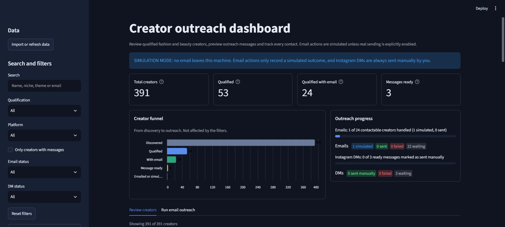
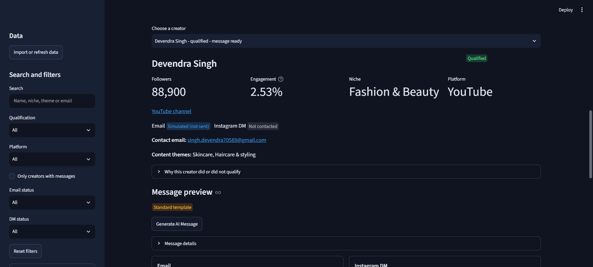
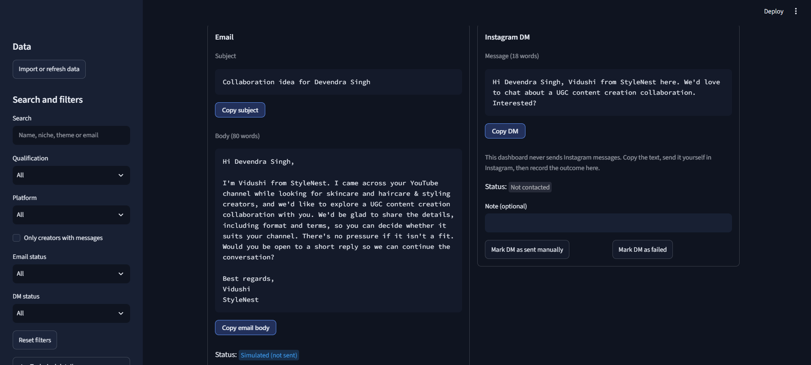
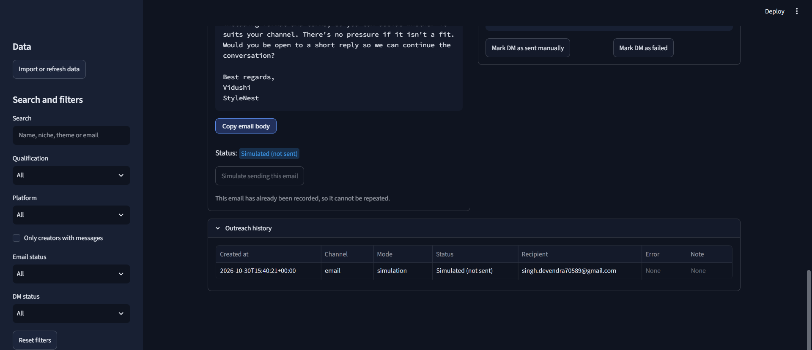
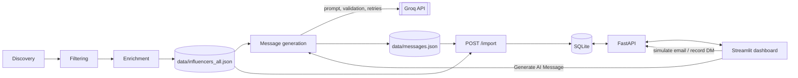

# StyleNest – Automated Micro-Influencer Outreach System

EDXSO AI Engineer Intern – Assignment 1.

A Python system that finds fashion and beauty micro-influencers on YouTube for the fictional brand **StyleNest**,
qualifies them, enriches their profiles, writes a personalised email and Instagram DM for each qualified creator with
an LLM (Groq), and tracks every contact attempt in a review dashboard. **Nothing is sent automatically**: email
actions are simulated by default and Instagram DMs are always sent manually by the user.



## Results at a glance

| Stage | Count (from the dashboard) |
|---|---|
| Creators discovered | 391 |
| Qualified | 53 |
| Qualified with a public contact email | 24 |
| Qualified creators with a message ready | 3 (more can be generated on demand) |
| Emails recorded as simulated | 1 |

The 50+ influencer requirement is met by both the discovered set (391) and the qualified set (53).

## Technology stack

- **Language:** Python 3
- **AI:** Groq chat-completions API through the `groq` SDK
- **Backend:** FastAPI served with `uvicorn`
- **Dashboard:** Streamlit, pandas, requests
- **Database:** SQLite
- **Data models:** Pydantic (`outreach/models.py`)
- **Configuration:** `.env` file loaded with python-dotenv
- **Testing:** pytest (including Streamlit `AppTest` for the dashboard)

## APIs and tools used

| Tool | Used for |
|---|---|
| Public YouTube channel data (API) | Discovering creators and reading channel statistics, recent videos and public channel descriptions |
| Groq API | Generating the email, subject and Instagram DM |
| FastAPI | Import, creator queries, statistics and outreach actions |
| SQLite | Creators, messages and the outreach log |
| Streamlit | Review, message generation and outreach tracking UI |

## Data sources

All creator data comes from public YouTube channel information: channel name and URL, subscriber count, engagement
derived from recent videos, recent video titles and the public channel description. Contact emails are only taken
from what creators publish publicly. Values the public API does not provide are left empty.

## Discovery methodology

Phase 1 (`python -m outreach.pipeline`) collects fashion and beauty creators from YouTube and writes every creator it
found, qualified or not, to `data/influencers_all.json`. Keeping the rejected creators makes the funnel transparent:
391 creators were discovered, well above the 50 required.

## Filtering logic

Each creator is evaluated against the qualification criteria and stored with:

- `filter_status`: `PASS` or `FAIL`
- `filter_reasons`: one line per criterion, for example `PASS platform: YouTube` or `PASS followers: 12,000`

The dashboard shows the result and the reasons for any creator under **Why this creator did or did not qualify**, and
can filter by qualification. Only `PASS` creators (53) are ever given messages or outreach actions.



## Enrichment process

Qualified and discovered creators are enriched with: niche, content themes (e.g. "Skincare", "Haircare & styling"),
up to three recent video titles, public contact email with its source, Instagram URL, website and country when
available.

- A missing contact email is stored as `Not Found`, and email outreach is skipped for that creator.
- Missing follower or engagement values stay empty and are shown as unavailable rather than guessed.
- Instagram DMs need no email, so creators without an email can still be contacted manually.

## AI model and prompt

- **Model:** `openai/gpt-oss-120b` on Groq, set with the `GROQ_MODEL` variable (the code default is
  `llama-3.3-70b-versatile`). The model used is recorded in `data/messages.json`.
- **Service:** `outreach/llm_service.py` wraps the API with bounded retries, exponential backoff, `Retry-After`
  support and separate errors for missing keys, fatal API errors, transient errors and empty responses.
- **Prompt:** a system prompt (`SYSTEM_PROMPT` in `outreach/messaging.py`) asks for a JSON object
  `{"subject", "email", "dm"}` with these rules: email 60–90 words including greeting and sign-off, DM 15–30 words,
  subject at most 10 words, use only the facts supplied, quote only exact video titles, never claim to have watched
  or loved specific content, no placeholders, brackets or links. The user prompt is the sender and creator facts as JSON.

## Personalization logic

Only verified facts are sent to the model: creator name, platform, niche, content themes, up to three recent video
titles, and the sender's name, brand, brand description and collaboration type (UGC content creation). The creator's
email address, description and metrics are never sent.

**Validation and retries.** Each reply is parsed and checked: email 60–90 words, DM 15–30 words, subject at most 12
words, no placeholders or links, and any quoted text must be a provided video title. On failure the problems are fed
back to the model, for up to 3 attempts.

**Fallback.** If all attempts fail, or the creator has no themes or video titles, a deterministic template that uses
facts only is saved. It passes the same word limits and is labelled `fallback_template`; the dashboard shows it as
**Standard template**, never as AI-generated. Valid AI messages are labelled **AI-generated**.

**Batch generation (CLI)**

```bash
python -m outreach.messaging --limit 2    # at most 2 creators
python -m outreach.messaging              # all qualified creators without a valid message
python -m outreach.messaging --force      # regenerate even if a valid message exists
```

**On-demand generation in the dashboard.** In **Creator review**, choose any qualified creator:

- With no message or only a template, click **Generate AI Message**.
- With a valid AI message, the stored message is shown and no API call is made unless you click
  **Regenerate AI message**.

Only the selected creator is processed, using the same prompt, validation, retries and fallback. The result is saved
to `data/messages.json` and the tracker is refreshed. A failed regeneration never replaces a valid message, and no
Groq call happens unless a button is clicked.



## Sending mechanism

- **Email:** simulation by default. **Simulate sending this email** records a `simulated` outcome, labelled
  "Simulated (not sent)", and no email leaves the machine. Real SMTP sending exists in the code but is off unless it
  is explicitly enabled; the dashboard then shows a warning banner and requires a confirmation checkbox.
- **Instagram DM:** never sent by the system. Use **Copy DM**, send it yourself in Instagram, then click
  **Mark DM as sent manually** or **Mark DM as failed** (optional note).
- **Tracking:** every action is stored in an outreach log (channel, mode, status, recipient, error, note) and shown
  in **Outreach history**. Statuses: `pending`, `sent`, `simulated`, `failed`, `skipped`.
- **Duplicate prevention:** database unique indexes allow one active or simulated email per creator and per email
  address (case-insensitive). A repeat attempt is rejected, and the dashboard disables the button with
  "This email has already been recorded, so it cannot be repeated." Re-importing data never resets statuses.



## Architecture



Workflow: Discovery → Filtering → Enrichment → AI Personalization → Review → Simulation/Manual sending → Tracking.

## Dashboard and API

Dashboard: **Import or refresh data**, search and filters, KPI cards, creator funnel and outreach progress, creator
table, **Creator review** (profile, qualification reasons, message preview with copy buttons, statuses, history) and
a **Run email outreach** tab for batch simulation.

API endpoints used by the dashboard:

| Method | Path | Purpose |
|---|---|---|
| GET | `/config` | email mode and whether real sending is on |
| GET | `/influencers` | list creators (filters: qualification, platform, email status, DM status) |
| GET | `/influencers/{channel_id}` | one creator with history |
| GET | `/stats` | KPI and funnel counts |
| POST | `/import` | load the JSON files into SQLite |
| POST | `/outreach/email/{channel_id}` | simulate (or send) one email |
| POST | `/outreach/email/run` | batch run with a limit |
| POST | `/outreach/dm/{channel_id}/status` | record the manual DM outcome |

FastAPI's interactive docs are available at `http://127.0.0.1:8000/docs` while the API is running.

## Sample output

Creator shown in the dashboard: **Devendra Singh** – YouTube, Fashion & Beauty, 88,900 followers, 2.53% engagement,
themes "Skincare" and "Haircare & styling", status Qualified, public contact email available.

Standard-template message (labelled as such, 80-word email, 18-word DM):

> **Subject:** Collaboration idea for Devendra Singh
> **DM:** Hi Devendra Singh, Vidushi from StyleNest here. We'd love to chat about a UGC content creation
> collaboration. Interested?

Clicking **Generate AI Message** replaces a template with a personalised AI message labelled **AI-generated**.

## Project structure

```
outreach/
  config.py        settings loaded from .env
  models.py        Influencer, RecentVideo
  pipeline.py      Phase 1: discovery, filtering, enrichment
  llm_service.py   Groq wrapper (retries, typed errors)
  messaging.py     prompts, validation, fallback, batch + single-creator generation
  db.py            SQLite schema, queries, duplicate prevention
  api.py           FastAPI backend
  view_helpers.py  dashboard formatting helpers
  dashboard.py     Streamlit UI
data/              influencers_all.json, messages.json
tests/             pytest suites
docs/screenshots/  dashboard screenshots used in this README
```

## Setup instructions (Windows, Git Bash)

```bash
git clone <your-repository-url> stylenest-outreach
cd stylenest-outreach
python -m venv .venv
source .venv/Scripts/activate
pip install -r requirements.txt
cp .env.example .env
```

Edit `.env` with your own values (never commit it). Main variables: `GROQ_API_KEY`, `GROQ_MODEL`, `BRAND_NAME`,
`SENDER_NAME`, plus the other keys listed in `.env.example`. The dashboard reads `API_URL`
(default `http://127.0.0.1:8000`).

Run (two terminals, virtual environment active in each):

```bash
# optional: rebuild the datasets and pre-generate a few messages
python -m outreach.pipeline
python -m outreach.messaging --limit 2

# terminal 1 - API
uvicorn outreach.api:create_app --factory

# terminal 2 - dashboard (opens http://localhost:8501)
streamlit run outreach/dashboard.py
```

On first launch, click **Import or refresh data** in the dashboard sidebar.

## Running tests

```bash
python -m pytest -q
```

Tests use mocked Groq clients and fake APIs, so they need no network, API key or SMTP server. They cover the Groq
wrapper (retries, errors, empty responses), message parsing, validation, fallback and batch runs, single-creator
generation, message-to-creator matching, import idempotency, duplicate-outreach prevention and the dashboard.

## Limitations

- Email is simulated by default and Instagram DMs are manual; there is no automatic Instagram sending.
- Only public YouTube data is used. Follower, engagement and contact-email coverage depends on what creators publish
  (24 of 53 qualified creators have a public email).
- AI messages use only the supplied facts (name, themes, recent video titles); they do not analyse video content.
- Creators without themes or video titles receive a standard template instead of an AI message.
- Groq rate limits can interrupt batch generation; re-running resumes and reuses valid messages.
- On-demand generation runs inside the Streamlit process, so the Groq key must be available to it.
- The system is for local use and has no authentication or deployment.

## Assignment requirements checklist

| Requirement | Where it is implemented |
|---|---|
| Discover 50+ influencers | 391 discovered, 53 qualified (`data/influencers_all.json`) |
| Filter / classify | `filter_status` and `filter_reasons`, shown in the dashboard |
| Profile enrichment | Contact email, themes, recent videos, Instagram, website, country |
| Personalised email (60–90 words) | `outreach/messaging.py`, enforced by validation |
| Personalised Instagram DM (15–30 words) | `outreach/messaging.py`, enforced by validation |
| Sending layer | Simulated email, manual Instagram DM |
| Outreach tracking and duplicate prevention | `outreach_log` table, unique indexes, dashboard history |
| Dashboard | Streamlit app (`outreach/dashboard.py`) |
| Documentation | This README |
